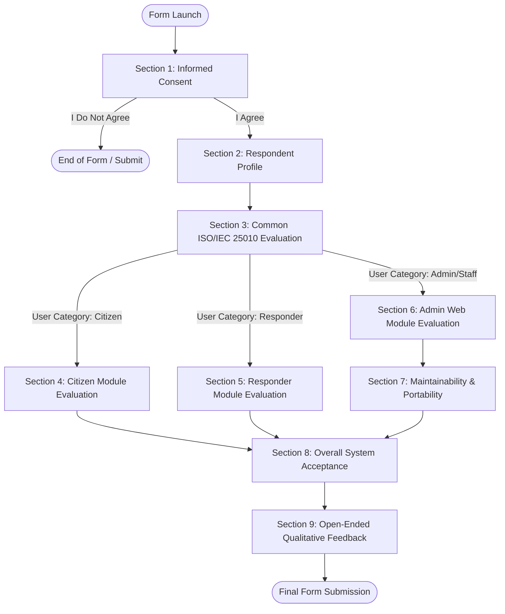

# User Acceptance Testing (UAT) and ISO/IEC 25010 Quality Evaluation Survey for SALBA

## Form Description
The User Acceptance Testing questionnaire evaluates SALBA using selected software product quality characteristics aligned with ISO/IEC 25010.

Welcome to the User Acceptance Testing (UAT) and Quality Evaluation Survey for SALBA (Sophisticated Aid, Life-saving Backup, Assistance) — an emergency reporting, response coordination, and CDRRMO management system for Malaybalay City.

**Instructions for Evaluators:**
1. Please evaluate SALBA based on your actual experience using the system during testing.
2. Complete only the section assigned to your specific user role (Citizen, CDRRMO Responder/Rescuer, or CDRRMO Admin/Staff).
3. Responses will be used exclusively for system validation, system improvement, academic research, and official capstone documentation.
4. There are no right or wrong answers; we request your honest, objective feedback.
5. All quality criteria are rated using a 5-point Likert scale (5 – Strongly Agree to 1 – Strongly Disagree) or N/A (Not Applicable / Feature Not Tested).

---

## Section 1: Informed Consent

### Question 1.1: Statement of Informed Consent
**Question:** Please review the consent information below before proceeding:
- **Purpose of Evaluation:** To validate the functionality, usability, performance, reliability, security, and operational suitability of the SALBA Emergency Response System.
- **Voluntary Participation:** Your participation in this evaluation is entirely voluntary. You may decline or withdraw at any time without penalty.
- **Confidentiality & Data Privacy:** All collected data will be treated with strict confidentiality in compliance with the Data Privacy Act of 2012 (RA 10173). Personal details (name, email) are optional. Aggregate survey results will be presented in academic publications and research documentation.
- **Data Retention:** Survey data will be securely stored during the project evaluation phase and archived upon capstone completion.
- **Risks & Benefits:** There are no physical risks associated with this evaluation. Your evaluation directly contributes to enhancing emergency response technology for Malaybalay City.
- **Contact Information:** For questions regarding this research, please contact the SALBA Development Team at `[Insert Researcher Email]`.

Do you voluntarily agree to participate in this evaluation?
- **Question Type:** Multiple choice
- **Required:** Yes
- **Choices:**
  - I Agree
  - I Do Not Agree
- **Branching Instructions:**
  - If **I Agree** $\rightarrow$ Go to **Section 2: Respondent Profile**
  - If **I Do Not Agree** $\rightarrow$ Go to **Form Submission / End of Form**

---

## Section 2: Respondent Profile

### Question 2.1: Full Name
- **Question:** Full Name (Optional)
- **Question Type:** Short answer
- **Required:** No

### Question 2.2: Email Address
- **Question:** Email Address (Optional)
- **Question Type:** Short answer
- **Required:** No

### Question 2.3: Date of Testing
- **Question:** Date of UAT Execution
- **Question Type:** Date
- **Required:** Yes

### Question 2.4: Primary Evaluator Category
- **Question:** What is your primary user role / category in evaluating SALBA?
- **Question Type:** Multiple choice
- **Required:** Yes
- **Choices:**
  - Main User / Citizen of Malaybalay
  - CDRRMO Responder / Rescuer
  - CDRRMO Admin / Staff (Web System)
- **Branching Instructions:**
  - If **Main User / Citizen of Malaybalay** $\rightarrow$ Go to **Section 3: Common ISO/IEC 25010 Evaluation** (then routed to Section 4)
  - If **CDRRMO Responder / Rescuer** $\rightarrow$ Go to **Section 3: Common ISO/IEC 25010 Evaluation** (then routed to Section 5)
  - If **CDRRMO Admin / Staff (Web System)** $\rightarrow$ Go to **Section 3: Common ISO/IEC 25010 Evaluation** (then routed to Section 6 & Section 7)

### Question 2.5: Testing Device Used
- **Question:** What device(s) did you use during the testing session?
- **Question Type:** Checkboxes
- **Required:** Yes
- **Choices:**
  - Android phone
  - iPhone
  - Tablet
  - Laptop
  - Desktop computer
  - Other

### Question 2.6: Web Browser Used (For Web System Evaluators)
- **Question:** What web browser did you use during testing?
- **Question Type:** Multiple choice
- **Required:** Yes
- **Choices:**
  - Google Chrome
  - Microsoft Edge
  - Mozilla Firefox
  - Safari
  - Mobile App / Integrated Browser
  - Other

---

## Section 3: Common ISO/IEC 25010 Evaluation

*All evaluators must complete this section based on their overall system interaction.*

### Grid 3.A: Functional Suitability Evaluation
- **Grid Title:** A. Functional Suitability
- **Question Type:** Multiple-choice grid
- **Required:** Yes
- **Columns:**
  - 5 – Strongly Agree
  - 4 – Agree
  - 3 – Neutral
  - 2 – Disagree
  - 1 – Strongly Disagree
  - N/A – Not Applicable / Feature Not Tested
- **Rows:**
  - **FS1:** SALBA provides complete features necessary to complete emergency reporting, dispatch, or response tasks.
  - **FS2:** SALBA functions perform their intended emergency management tasks accurately and without logical errors.
  - **FS3:** The system provides appropriate output (e.g. status updates, alert cards, route paths) corresponding to input data.

### Grid 3.B: Performance Efficiency Evaluation
- **Grid Title:** B. Performance Efficiency
- **Question Type:** Multiple-choice grid
- **Required:** Yes
- **Columns:**
  - 5 – Strongly Agree
  - 4 – Agree
  - 3 – Neutral
  - 2 – Disagree
  - 1 – Strongly Disagree
  - N/A – Not Applicable / Feature Not Tested
- **Rows:**
  - **PE1:** The application responds quickly when submitting alerts, updating statuses, or loading dashboards.
  - **PE2:** Data updates (such as location updates and report status changes) occur within an acceptable timeframe.
  - **PE3:** The application operates smoothly without lagging or crashing during regular use.

### Grid 3.C: Compatibility Evaluation
- **Grid Title:** C. Compatibility
- **Question Type:** Multiple-choice grid
- **Required:** Yes
- **Columns:**
  - 5 – Strongly Agree
  - 4 – Agree
  - 3 – Neutral
  - 2 – Disagree
  - 1 – Strongly Disagree
  - N/A – Not Applicable / Feature Not Tested
- **Rows:**
  - **CO1:** SALBA functions correctly on my tested operating system and hardware device.
  - **CO2:** The web/mobile interface renders appropriately across different screen sizes and resolutions.
  - **CO3:** The application integrates smoothly with essential device features (such as GPS location services and camera).

### Grid 3.D: Usability Evaluation
- **Grid Title:** D. Usability
- **Question Type:** Multiple-choice grid
- **Required:** Yes
- **Columns:**
  - 5 – Strongly Agree
  - 4 – Agree
  - 3 – Neutral
  - 2 – Disagree
  - 1 – Strongly Disagree
  - N/A – Not Applicable / Feature Not Tested
- **Rows:**
  - **US1:** Navigation controls, buttons, and menus are easy to understand and locate.
  - **US2:** Text labels, status indicators, and emergency instructions are clear and unambiguous.
  - **US3:** I can successfully complete my assigned emergency tasks with minimal effort or training.
  - **US4:** Visual layouts, color codes (severity badges), and icons are clear and aesthetically pleasing.
  - **US5:** Warning prompts (e.g. anti-false-report warnings) effectively guide proper system usage.

### Grid 3.E: Reliability Evaluation
- **Grid Title:** E. Reliability
- **Question Type:** Multiple-choice grid
- **Required:** Yes
- **Columns:**
  - 5 – Strongly Agree
  - 4 – Agree
  - 3 – Neutral
  - 2 – Disagree
  - 1 – Strongly Disagree
  - N/A – Not Applicable / Feature Not Tested
- **Rows:**
  - **RE1:** SALBA maintains stable operation without unexpected application crashes or freezes.
  - **RE2:** Emergency alerts and mission status records remain accurately stored and retrieved across sessions.
  - **RE3:** Error messages (such as missing network or disabled GPS) are informative and handle issues gracefully.

### Grid 3.F: Security Evaluation
- **Grid Title:** F. Security
- **Question Type:** Multiple-choice grid
- **Required:** Yes
- **Columns:**
  - 5 – Strongly Agree
  - 4 – Agree
  - 3 – Neutral
  - 2 – Disagree
  - 1 – Strongly Disagree
  - N/A – Not Applicable / Feature Not Tested
- **Rows:**
  - **SE1:** User authentication (login/register) securely grants access based on authorized user roles.
  - **SE2:** Restricted functions (such as admin dispatch and rescuer tracking) cannot be accessed by unauthorized users.
  - **SE3:** Personal info (phone numbers, user profile details) is protected during storage and transmission.

---

## Section 4: Main User / Citizen Module Evaluation (DisasterSOS App)

*This section is completed ONLY by respondents who selected "Main User / Citizen of Malaybalay".*

### Question 4.1: Citizen Features Tested Checkbox
- **Question:** Which SALBA citizen features (`DisasterSOS` Mobile App) did you test during this evaluation?
- **Question Type:** Checkboxes
- **Required:** Yes
- **Choices:**
  - One-Tap Emergency Reporting & Disaster Type Selection
  - Automatic GPS Location Capture & Barangay Geocoding
  - Anti-Spam Cooldown Timer & False Report Warning Dialog
  - Photo Attachment via Camera / Gallery Upload
  - Active Alert Status Polling & Status Tracking
  - Incident Alert History & Details Screen
  - User Authentication (Registration, Email Login, Google OAuth2)
  - Incident Map & Live Rescuer Route Visualization

### Grid 4.2: DisasterSOS Mobile App Module Evaluation
- **Grid Title:** Citizen Module Functional & Quality Statements
- **Question Type:** Multiple-choice grid
- **Required:** Yes
- **Columns:**
  - 5 – Strongly Agree
  - 4 – Agree
  - 3 – Neutral
  - 2 – Disagree
  - 1 – Strongly Disagree
  - N/A – Not Applicable / Feature Not Tested
- **Rows:**
  - **CIT_01 [One-Tap Reporting]:** Selecting a disaster type (Flood, Fire, Earthquake, Landslide, Typhoon) and submitting an alert is straightforward and quick.
  - **CIT_02 [GPS & Location]:** The app automatically captures my current device GPS coordinates and maps them to the correct Malaybalay barangay location.
  - **CIT_03 [Warning & Cooldown]:** The 60-second cooldown timer and false report warning prompt prevent accidental or duplicate emergency submissions.
  - **CIT_04 [Camera Upload]:** Capturing an incident photo or choosing to skip photo submission works reliably during alert creation.
  - **CIT_05 [Status Polling]:** The app accurately updates the active report status (new, acknowledged, en route, ongoing, resolved) during polling.
  - **CIT_06 [Alert History]:** The Alert History screen correctly displays past submitted reports with accurate dates, disaster categories, and resolution statuses.
  - **CIT_07 [Authentication]:** Account registration, email login, and Google Sign-In operate smoothly and securely maintain my user session.
  - **CIT_08 [Map & Route View]:** The interactive map accurately displays my incident marker and the assigned rescuer's route path when available.

*Branching: Upon completing Section 4 $\rightarrow$ Go to **Section 8: Overall System Acceptance***

---

## Section 5: CDRRMO Responders / Rescuers Module Evaluation (RescuerApp)

*This section is completed ONLY by respondents who selected "CDRRMO Responder / Rescuer".*

### Question 5.1: Responder Features Tested Checkbox
- **Question:** Which SALBA responder features (`RescuerApp` Mobile App) did you test during this evaluation?
- **Question Type:** Checkboxes
- **Required:** Yes
- **Choices:**
  - Rescuer Authentication & Username Credentials Login
  - Mission Dashboard & Victim Details View
  - Mission Status Transitions (On The Way $\rightarrow$ Arrived/Ongoing $\rightarrow$ Resolved)
  - Resolution Photo Upload Proof Submission
  - Real-Time Background GPS Streaming via Socket.IO
  - Socket.IO Real-Time Dispatch Alert Notifications & Sound/Vibration Alerts
  - Mission Map with Driving Polyline Route Navigation
  - Notification History & Rescuer Duty Status Toggle

### Grid 5.2: RescuerApp Mobile App Module Evaluation
- **Grid Title:** Responder Module Functional & Quality Statements
- **Question Type:** Multiple-choice grid
- **Required:** Yes
- **Columns:**
  - 5 – Strongly Agree
  - 4 – Agree
  - 3 – Neutral
  - 2 – Disagree
  - 1 – Strongly Disagree
  - N/A – Not Applicable / Feature Not Tested
- **Rows:**
  - **RES_01 [Rescuer Auth]:** Logging into the Rescuer App using designated rescuer credentials is secure and reliable.
  - **RES_02 [Mission Dashboard]:** The mission dashboard clearly displays assigned emergency details, victim contact info, and incident location.
  - **RES_03 [Status Updates]:** Updating mission status (`on_the_way`, `ongoing`, `resolved`) works immediately and reflects correctly in the system.
  - **RES_04 [Resolution Proof]:** Uploading a photo proof upon completing a mission functions properly and validates resolution.
  - **RES_05 [Real-Time Tracking]:** Background GPS tracking smoothly broadcasts my live location to the command center while on duty.
  - **RES_06 [Socket Alerts]:** Real-time dispatch popup alerts and audio/vibration notifications trigger instantly when a mission is assigned.
  - **RES_07 [Route Navigation]:** The interactive mission map displays accurate turn-by-turn road polyline routes to the victim's location.
  - **RES_08 [Notification Log]:** The notification tab maintains a reliable history of past mission dispatches and team updates.

*Branching: Upon completing Section 5 $\rightarrow$ Go to **Section 8: Overall System Acceptance***

---

## Section 6: CDRRMO Admin / Staff (Web System) Module Evaluation (AdminWebApp)

*This section is completed ONLY by respondents who selected "CDRRMO Admin / Staff (Web System)".*

### Question 6.1: Admin Web Features Tested Checkbox
- **Question:** Which SALBA administrative web features (`AdminWebApp` Web Dashboard) did you test during this evaluation?
- **Question Type:** Checkboxes
- **Required:** Yes
- **Choices:**
  - Admin Web Authentication & Role-Based Security
  - Real-Time Incident Monitoring Feed (Socket.IO Live Feed)
  - AI Verification Badges, Severity Scoring & False Alarm Flags
  - Rescue Team Management & Manual Team Dispatching (Alpha, Bravo, Charlie, Delta)
  - Rescuer Fleet Tracking Panel & Live Map Markers
  - Disaster Analytics, Spatio-Temporal Clustering & Hazard Zone Map
  - CDRRMO Situation Report (SITREP) Generator & PDF Export
  - User Management, Feedback Reviews & Bilingual Terminology Settings

### Grid 6.2: AdminWebApp Module Evaluation
- **Grid Title:** Administrative Web System Module Quality Statements
- **Question Type:** Multiple-choice grid
- **Required:** Yes
- **Columns:**
  - 5 – Strongly Agree
  - 4 – Agree
  - 3 – Neutral
  - 2 – Disagree
  - 1 – Strongly Disagree
  - N/A – Not Applicable / Feature Not Tested
- **Rows:**
  - **ADM_01 [Admin Login]:** The administrator login securely restricts web portal access strictly to authorized CDRRMO personnel.
  - **ADM_02 [Live Incident Feed]:** New emergency alerts appear instantly on the dashboard map and list feed without requiring manual page refreshes.
  - **ADM_03 [AI Verification]:** AI-generated confidence scores, severity assessments, and prank/false-alarm warning badges assist in rapid decision-making.
  - **ADM_04 [Manual Dispatch]:** Selecting available rescue teams (Alpha, Bravo, Charlie, Delta) and executing manual dispatches is intuitive and fast.
  - **ADM_05 [Fleet Tracking]:** The Rescuer Panel accurately tracks active responders, their current online status, duty state, and real-time coordinates.
  - **ADM_06 [Analytics & Clusters]:** Incident density maps, multi-report clustering indicators, and hazard zone overlays provide clear situational awareness.
  - **ADM_07 [SITREP & PDF]:** Generating formal CDRRMO Situation Reports (SITREPs) and downloading PDF incident summary reports operates correctly.
  - **ADM_08 [System Management]:** User account oversight, AI feedback loops, user feedback management, and bilingual dictionary controls are easy to manage.

---

## Section 7: Maintainability and Portability Evaluation (Authorized Technical/Admin Evaluators)

*This section is completed by CDRRMO Admin / Staff and Technical Evaluators.*

### Grid 7.1: Observable Maintainability & Portability Evaluation
- **Grid Title:** Maintainability and Portability Characteristics
- **Question Type:** Multiple-choice grid
- **Required:** Yes
- **Columns:**
  - 5 – Strongly Agree
  - 4 – Agree
  - 3 – Neutral
  - 2 – Disagree
  - 1 – Strongly Disagree
  - N/A – Not Applicable / Feature Not Tested
- **Rows:**
  - **MP_01 [Error Clarity]:** The system displays readable, actionable error notices when server connections or network requests fail.
  - **MP_02 [Update Stability]:** Applied backend configurations or dataset updates take effect without breaking existing active sessions.
  - **MP_03 [Cross-Browser Portability]:** The administrative web application functions uniformly across Chrome, Edge, Firefox, and Safari.
  - **MP_04 [Mobile OS Portability]:** The mobile applications maintain full usability across different Android and iOS screen resolutions.
  - **MP_05 [Network Adaptability]:** The application gracefully handles shifting network conditions (3G/4G/5G/Wi-Fi) across Malaybalay City.

*Branching: Upon completing Section 7 $\rightarrow$ Go to **Section 8: Overall System Acceptance***

---

## Section 8: Overall System Acceptance

*All evaluators must complete this final section.*

### Grid 8.1: Overall System Acceptance Evaluation
- **Grid Title:** Overall System Acceptance Statements
- **Question Type:** Multiple-choice grid
- **Required:** Yes
- **Columns:**
  - 5 – Strongly Agree
  - 4 – Agree
  - 3 – Neutral
  - 2 – Disagree
  - 1 – Strongly Disagree
- **Rows:**
  - **OA1:** SALBA meets the functional requirements expected for my specific role.
  - **OA2:** SALBA is well-suited for emergency reporting, response coordination, and CDRRMO operations in Malaybalay City.
  - **OA3:** I would be willing to use SALBA during actual emergency situations and daily dispatch operations.
  - **OA4:** I would recommend SALBA to other citizens, rescuers, or disaster management personnel.
  - **OA5:** Overall, I am satisfied with the capabilities, visual design, and performance of SALBA.

### Question 8.2: Global Rating of SALBA System
- **Question:** Overall Score of SALBA Emergency System
- **Question Type:** Linear scale
- **Scale:** 1 to 5 (1 = Very Poor, 5 = Excellent)
- **Required:** Yes

---

## Section 9: Open-Ended Qualitative Feedback

### Question 9.1: Most Useful Module
- **Question:** Which SALBA module or feature was most useful and effective during your evaluation?
- **Question Type:** Paragraph
- **Required:** No

### Question 9.2: Priority Improvement Needed
- **Question:** Which specific module, interface, or feature needs the most improvement before full operational deployment?
- **Question Type:** Paragraph
- **Required:** No

### Question 9.3: Encountered Issues or Limitations
- **Question:** What errors, glitches, or usability difficulties did you encounter during testing?
- **Question Type:** Paragraph
- **Required:** No

### Question 9.4: Recommendations & Safeguards
- **Question:** What additional feature, revision, or operational safeguard do you recommend before CDRRMO deployment?
- **Question Type:** Paragraph
- **Required:** No

### Question 9.5: Additional Remarks
- **Question:** Any additional comments or suggestions regarding SALBA?
- **Question Type:** Paragraph
- **Required:** No

---

## Google Forms Branching Map

### Detailed Section Routing Table
1. **Section 1 (Informed Consent):**
   - Option `I Agree` $\rightarrow$ Route to **Section 2**.
   - Option `I Do Not Agree` $\rightarrow$ Route to **Submit Form**.
2. **Section 2 (Respondent Profile) & Section 3 (Common ISO Evaluation):**
   - After completing common ISO grids, route based on `User Category` (Question 2.4):
     - `Main User / Citizen of Malaybalay` $\rightarrow$ Route to **Section 4**.
     - `CDRRMO Responder / Rescuer` $\rightarrow$ Route to **Section 5**.
     - `CDRRMO Admin / Staff (Web System)` $\rightarrow$ Route to **Section 6**.
3. **Role Module Sections:**
   - **Section 4 (Citizen):** After completion $\rightarrow$ Route to **Section 8**.
   - **Section 5 (Responder):** After completion $\rightarrow$ Route to **Section 8**.
   - **Section 6 (Admin Web):** After completion $\rightarrow$ Route to **Section 7**.
4. **Technical / Admin Section:**
   - **Section 7 (Maintainability & Portability):** After completion $\rightarrow$ Route to **Section 8**.
5. **Final Sections:**
   - **Section 8 (Overall Acceptance):** Route to **Section 9**.
   - **Section 9 (Open-Ended Feedback):** Route to **Submit Form**.

---

## Feature Coverage Matrix

| User Category | Actual SALBA Module / Feature | Functional Suitability Item(s) | Usability Item(s) | Reliability / Performance / Security Item(s) | Included in UAT: Yes/No |
| :--- | :--- | :--- | :--- | :--- | :---: |
| **Citizen** | Emergency One-Tap Reporting | CIT_01, FS1 | US1, US3, US4 | PE1, RE1 | **Yes** |
| **Citizen** | Auto GPS & Malaybalay Barangay Geocoding | CIT_02, FS2 | US2 | CO3, RE2 | **Yes** |
| **Citizen** | Anti-Spam Cooldown Timer & Warning Dialog | CIT_03, FS3 | US5 | SE3 | **Yes** |
| **Citizen** | Photo Capture & Cloudinary Upload | CIT_04, FS1 | US3 | CO3, RE1 | **Yes** |
| **Citizen** | Active Alert Status Polling (5s Interval) | CIT_05, FS3 | US2 | PE2, RE2 | **Yes** |
| **Citizen** | Incident Alert History & Details View | CIT_06, FS1 | US1, US4 | RE2, SE1 | **Yes** |
| **Citizen** | User Auth (Email, Register, Google OAuth) | CIT_07, FS2 | US3 | SE1, SE3 | **Yes** |
| **Citizen** | Incident Map & Rescuer Route Overlay | CIT_08, FS3 | US4 | CO2, PE2 | **Yes** |
| **Responder** | Rescuer Username Auth & Session Management | RES_01, FS2 | US1 | SE1, SE2 | **Yes** |
| **Responder** | Mission Dashboard & Victim Details Display | RES_02, FS1 | US2, US4 | RE2 | **Yes** |
| **Responder** | Mission Status Progress (`on_the_way` $\rightarrow$ `ongoing` $\rightarrow$ `resolved`) | RES_03, FS3 | US3 | PE2, RE1 | **Yes** |
| **Responder** | Resolution Photo Upload Verification | RES_04, FS2 | US3 | RE2 | **Yes** |
| **Responder** | Real-Time Background GPS Streaming (Socket.IO) | RES_05, FS2 | US3 | PE2, CO3, SE3 | **Yes** |
| **Responder** | Socket.IO Dispatch Alerts & Audio/Vibration Prompts | RES_06, FS3 | US2 | PE1, RE3 | **Yes** |
| **Responder** | Mission Map & Turn-by-Turn Road Routing | RES_07, FS3 | US4 | CO2, PE2 | **Yes** |
| **Responder** | Notification History & Duty Status Toggle | RES_08, FS1 | US1 | RE2, SE2 | **Yes** |
| **Admin / Staff** | Admin Portal Auth & JWT Access Control | ADM_01, FS2 | US1 | SE1, SE2 | **Yes** |
| **Admin / Staff** | Real-Time Live Dashboard & Socket.IO Event Feed | ADM_02, FS1 | US4 | PE1, PE2, RE1 | **Yes** |
| **Admin / Staff** | AI Report Verification, Severity Scoring & False Alarm Badges | ADM_03, FS3 | US2, US4 | PE1, RE2 | **Yes** |
| **Admin / Staff** | Team Management & Manual Dispatching (Alpha - Delta) | ADM_04, FS1 | US3 | PE2, SE2 | **Yes** |
| **Admin / Staff** | Rescuer Fleet Tracking & Live Map Coordinates | ADM_05, FS2 | US4 | PE2, CO3 | **Yes** |
| **Admin / Staff** | Incident Density Maps & Spatial Clustering | ADM_06, FS3 | US4 | PE1, CO2 | **Yes** |
| **Admin / Staff** | CDRRMO Situation Report (SITREP) & PDF Export | ADM_07, FS1 | US3 | RE2, CO1 | **Yes** |
| **Admin / Staff** | User Oversight, AI Feedback Loop & Bilingual Dictionary | ADM_08, FS2 | US1 | MP_02, SE3 | **Yes** |
| **Technical / Admin** | System Error Logging & Server Diagnostics | MP_01, FS2 | US2 | MP_01, RE3 | **Yes** |
| **Technical / Admin** | System Hot-Reloading & Uptime Stability | MP_02, FS2 | N/A | MP_02, RE1 | **Yes** |
| **Technical / Admin** | Cross-Browser Web Compatibility | MP_03, FS3 | US4 | MP_03, CO1 | **Yes** |
| **Technical / Admin** | Mobile Device OS Portability (Android/iOS) | MP_04, FS3 | US4 | MP_04, CO2 | **Yes** |
| **Technical / Admin** | Cellular & Wi-Fi Network Adaptability | MP_05, FS3 | N/A | MP_05, RE1 | **Yes** |

---

## Features Excluded From UAT Due to Unavailability or Incomplete Implementation

The following features were identified during codebase auditing as either intentionally excluded, partially implemented, or unavailable for testing in the current version of SALBA:

1. **Fully Automated AI Dispatch without Admin Verification**
   - **Reason for Exclusion:** The system architecture intentionally enforces human-in-the-loop dispatching. While AI models generate severity predictions and confidence flags (`admin_can_dispatch`, `admin_review`, `flag_false_alarm`), emergency dispatches must be manually approved and triggered by a CDRRMO administrator for safety, accountability, and operational protocol.
2. **Responder Dispatch Decline / Reject Action**
   - **Reason for Exclusion:** The mobile application interface for rescuers does not include a "Decline Dispatch" function. Assigned emergency dispatches transition directly to active status, and status progression is restricted to operational stages (`on_the_way` $\rightarrow$ `ongoing` $\rightarrow$ `resolved`).
3. **Citizen Mobile App Socket.IO WebSockets**
   - **Reason for Exclusion:** Real-time updates in the citizen mobile app (`DisasterSOS`) rely on active HTTP polling (at 5-second intervals via `GET /api/alerts/my-reports`) rather than persistent Socket.IO WebSocket connections. Socket.IO is exclusively utilized within the `RescuerApp` and `AdminWebApp`.
4. **Direct Web Pipeline to Standalone Python Flask ML Microservice**
   - **Reason for Exclusion:** In the active production web pipeline, report verification and risk assessment are processed via the integrated Groq LLM API and Node.js heuristics engine (`enhancedMLModel.js`). The Python Flask Random Forest/XGBoost microservice (`salba-ml-service`) is fully implemented and trained, but operates as a secondary microservice exposed through dedicated `/api/ml` evaluation endpoints rather than the default primary alert creation flow.
